# Spend Analytics

One view of every retail customer's spend across **six source systems**
(CRM, core banking, card switch, UPI switch, net banking / bill pay, ATM
switch), linked on the customer key (CIF). Every spend event gets a
**category**: UPI payments, most of today's transactions, carry no MCC, so a
**MiniLM** embedding model (blended with character n-grams) categorises the
free-text payee names. On top of that, a daily run builds **personas**
(KMeans, IDs stable across runs), a **12-week cohort x category spend
forecast** (**Chronos-2**, gated against a seasonal-naive baseline) and
rule-based **opportunity signals** for marketing (travel surge, festive
electronics, relocation).

> Demo of a governed data + ML pipeline on synthetic data. The generator
> plants the archetypes and the seasonality, so recovery metrics partly
> measure the generator. Personas are descriptive segments, not a credit or
> pricing model; signals suggest who to talk to, and nothing is offered to a
> customer automatically (offers need the bank's consent and marketing rules).

## Architecture

```mermaid
flowchart LR
  A[CDE Spark<br/>generate_spend_bronze<br/>6 source systems] --> B[dq_bronze<br/>Great Expectations]
  B --> C[build_silver<br/>dedupe, CIF resolution,<br/>spend_event + location]
  C --> D[dq_silver]
  D --> CAT[CAI Job<br/>spend-categorise<br/>MCC, seed, MiniLM kNN]
  CAT --> MAP[(ref.merchant_category_map)]
  MAP --> E[build_gold_features<br/>CIF x week, cohort x category,<br/>mix; MERGE]
  E --> F[dq_gold]
  F --> FE[CAI Job<br/>feature-engineering]
  FE --> TR[CAI Job<br/>model-training<br/>KMeans, MiniLM, Chronos-2]
  TR --> EV[CAI Job<br/>model-evaluation<br/>KPI gate]
  B & D & F -. results .-> Q[(ref.dq_results)]
  EV --> H[(gold: personas, forecast,<br/>backtest, signals, model_run)]
  EV -. params, KPIs .-> M[CAI Experiments<br/>MLflow]
  H --> I[CAI Application<br/>Spend Insights Console]
  H --> J[CDW Impala / Hue<br/>reports, time travel]
  I -. profile, forecast,<br/>what-if, categorise .-> K[CAI Model endpoint<br/>predict.py]
  AF[CDE Airflow DAG<br/>daily 02:30 IST] -. orchestrates .-> A
  AF -. API v2 .-> CAT & FE
  GH[GitHub Actions<br/>test, train-validate,<br/>cai-pipeline] -. API v2: sync-code, then the<br/>three jobs, gate as a dry run .-> FE
```



| Layer | Cloudera service | Code |
|---|---|---|
| Ingest + medallion | CDE Spark, Iceberg v2 | `cde/jobs/` |
| Data quality gates | CDE Spark + Great Expectations 1.23.2 | `cde/jobs/dq_check.py --layer bronze\|silver\|gold` |
| Orchestration | CDE Airflow | `cde/dags/spend_dag.py`, `cde/scripts/deploy_dag.sh` |
| Categorisation | CAI Job `spend-categorise` | `cai/jobs/categorise.py` |
| Daily ML + KPI gate | CAI Jobs: Feature Engineering → Model Training → Model Evaluation | `cai/jobs/{feature_engineering,train_models,evaluate_models}.py` |
| Experiment tracking | CAI Experiments (MLflow) | `spend/tracking.py`, experiment `spend-analytics` |
| On-demand | CAI Model Deployment `spend-scorer` | `cai/model/predict.py` |
| SQL + reports | CDW Impala (Hue) | `sql/reports.sql` |
| Spend Insights Console | CAI Application (Streamlit) | `app/` |
| CI: GitHub → Train & Validate → KPI Gate | GitHub Actions, then CAI Jobs via API v2 | `.github/workflows/ci.yml`, `ci/trigger_cai_pipeline.py` |

Databases: `rsingh_spend_anl_{bronze,silver,gold,ref}` (prefix in
`config/spend.yaml`, `--db-prefix` / `DB_PREFIX` on the CDE side; tables are
never prefixed).

| Table | Written by | Grain |
|---|---|---|
| `bronze.crm_customer` | CDE generate | CRM: customer, home pincode, segment, age and income band |
| `bronze.cbs_accounts` | CDE generate | core banking: accounts per CIF |
| `bronze.{card_master, card_txn}` | CDE generate | card switch: card hash → account, POS / e-commerce with MCC and merchant city |
| `bronze.{vpa_registry, upi_txn}` | CDE generate | UPI switch: VPA → account, P2M / P2P with a free-text payee and, for QR, a pincode |
| `bronze.nb_txn` | CDE generate | net banking / bill pay: biller type and name |
| `bronze.atm_txn` | CDE generate | ATM switch: withdrawals with the ATM id |
| `ref.{pincode_geo, mcc_category, category_taxonomy, atm_location, merchant_seed, calendar_weekly}` | CDE generate | lookups: pincode → city / tier / lat-lon, MCC → category, 14 categories, 2,559 seed merchants with their spellings, ATMs, festivals and salary weeks |
| `ref.archetype_truth` | CDE generate | the hidden archetype per customer (ARI only; never a model input) |
| `ref.merchant_category_map` | CAI categorise | merchant key → category, method, similarity; append-only |
| `ref.dq_results` | CDE dq_check | one row per expectation per run, with the table's Iceberg snapshot id |
| `silver.{customer, account}` | CDE silver | deduplicated entities |
| `silver.spend_event` | CDE silver | one row per spend event from all four channels: CIF, channel, merchant key, event city, `location_source`, `is_home` |
| `gold.spend_features` | CDE gold (MERGE) | CIF x weekly snapshot: 24 share columns, spend, trend, away share and weeks, 4-week category spend |
| `gold.spend_cohort_weekly` | CDE gold (MERGE) | 16 cohorts x 14 categories x week, with the calendar covariates |
| `gold.spend_mix_weekly` | CDE gold (MERGE) | week x dimension x value x channel (the app's book-wide views) |
| `gold.{customer_persona, persona_profile, persona_flow}` | CAI evaluation | run date x customer / persona / persona move |
| `gold.{spend_forecast, spend_backtest}` | CAI evaluation | run date x series x week: P10 / P50 / P90, naive (and actual in the backtest) |
| `gold.spend_signals` | CAI evaluation | run date x customer x signal: metric, threshold, action |
| `gold.spend_model_run` | CAI evaluation | run date: models, snapshot ids, KPIs, gate, MLflow run id |

The spec had one `spend-daily-run` job; it is three chained jobs here, handing
off through `artifacts/<run_date>/` (PLAN.md decision 1), and CI adds a
`train-validate` job with the KPI gate enforced (decision 2).

## Method (`config/policy.yaml`)

- **Categorise** (new merchant keys only, append-only map): MCC (card) →
  SEED (exact normalised name) → EMBEDDING (0.5 x MiniLM cosine + 0.5 x
  character 2-4 gram cosine, 5-NN vote plus a category-description prior,
  similarity ≥ 0.45) → FALLBACK (nearest category description, else OTHER).
  MiniLM alone reached 0.82; the blend reaches 0.93 (decision 11).
- **Location**: card POS uses the merchant city, UPI P2M the QR pincode, ATM
  the ATM's pincode; the rest falls back to home and says so
  (`location_source = home_fallback`, 48% of events on the 20k book, decision 4).
- **Personas**: KMeans on 27 standardised features (24 shares, log spend,
  digital and home share), clipped at ±3 sd, k in 5..9 by silhouette,
  IDs matched to the previous run (Hungarian), rule-based names.
- **Forecast**: Chronos-2 on the 224 cohort x category series with 5
  calendar covariates (festival, salary, month end, holidays, school fees),
  12 weeks, P10 / P50 / P90; a rolling backtest over 4 cut-offs against a
  same-week-last-year x trend baseline.
- **Signals**: TRAVEL_SURGE (4-week travel ≥ 3x the 9 weeks before),
  FESTIVE_ELECTRONICS (electronics in festival weeks), RELOCATION (3 of 4
  weeks mostly away, after a mostly-home norm).
- **KPI gate**: category accuracy ≥ 0.85 on a seed holdout and on card
  merchants with the MCC hidden; forecast WAPE ≤ 0.90 x the naive WAPE;
  P10-P90 coverage in [0.60, 0.95]; silhouette ≥ 0.15; persona stability ≥
  0.80 against the previous run; no regression against the champion (the
  published run it would replace: accuracy down at most 0.01, WAPE ratio up
  at most 0.03, set from an 8-Friday backfill, decision 22); and the run's
  feature hash equal to the code's (decision 21). A failed gate records the run
  (`gate_passed = false`) and the backtest as evidence, keeps yesterday's
  personas, forecast and signals live, and exits 1.

**Real numbers**, 20,000-customer book on a laptop CPU, run date
2026-09-25: category accuracy **0.926** (seed holdout, 1,412 names) and
**0.934** (2,932 card merchants, MCC hidden); Chronos-2 WAPE **0.151 vs
0.195** naive (ratio 0.775; 0.177 without covariates), P10-P90 coverage
0.765; 8 personas, silhouette 0.166, stability 0.958 vs the previous Friday,
ARI vs the hidden archetypes 0.654; 1,524 signals. The three jobs take 2 s,
44 s and 1 s. Cluster numbers at 200k go in `docs/PROJECT_LOG.md` once
measured.

Synthetic data: customers onboarded since 2008, extracts from April 2025, ~151 spend events each (58% UPI, 19%
card, 8% net banking, 14% ATM), 8,170 merchants with 2-5 spellings each, 7
hidden archetypes, Diwali / travel / school-fee seasonality, ~1.5%
relocating while the CRM keeps the old address, and three planted demo
customers (decision 10). Deterministic and prefix-stable; scale is a flag
(`--customers`), so tests and CI run small.

## Run locally

Python 3.11 and Java 17.

```bash
python3.11 -m venv .venv && .venv/bin/pip install -r requirements-dev.txt
export HF_HOME=$PWD/.hf_cache

# CDE jobs + GX gates on local Spark + Iceberg, with the categorise job between silver and gold
.venv/bin/python scripts/run_cde_local.py generate dq_bronze silver dq_silver --as-of 2026-09-25 --customers 20000
.venv/bin/python scripts/run_cde_local.py categorise --as-of 2026-09-25          # --stub: no torch
.venv/bin/python scripts/run_cde_local.py gold dq_gold export --as-of 2026-09-25
.venv/bin/python scripts/run_cde_local.py history                                # Iceberg snapshots of gold

# CAI jobs on parquet (drop --stub for MiniLM / Chronos-2; the first run downloads both)
.venv/bin/python cai/jobs/feature_engineering.py --backend parquet
.venv/bin/python cai/jobs/train_models.py
.venv/bin/python cai/jobs/evaluate_models.py --backend parquet
.venv/bin/python cai/jobs/daily_run.py --backend parquet --stub --ignore-gate    # all three in one process
.venv/bin/python cai/jobs/backfill_history.py --weeks 3 --backend parquet
.venv/bin/python cai/model/test_endpoint.py --local                             # profile, forecast, what-if, categorise

SPEND_STORAGE_BACKEND=parquet .venv/bin/streamlit run app/streamlit_app.py
.venv/bin/pytest -q
```

Experiments go to scratch folders (`--warehouse /tmp/x --parquet-dir /tmp/y`,
`SPEND_STORAGE_PARQUET_DIR`, `SPEND_STORAGE_ARTIFACTS_DIR`), never the default
`data/warehouse` / `data/parquet`.

## CI: GitHub → Train & Validate → KPI Gate

`.github/workflows/ci.yml`, on every push to `main` and every pull request:

- **`test`** (no torch): `pytest -q`; generate → dq_bronze → silver →
  dq_silver at 3,000 customers; categorise with the n-gram stub; gold →
  dq_gold → export; the three CAI stages with the stubs and `--ignore-gate`
  (the stub forecaster *is* the naive baseline, WAPE ratio 1.000); the DQ
  gate failing on cue with `--inject-bad-data`. The parquet book is handed on
  as an artifact.
- **`train-validate`** (needs `test`): CPU torch
  (`requirements-train-ci.txt`), the Hugging Face models cached, then the real
  MiniLM + Chronos-2 daily run on that book **with the gate enforced**. A
  change that makes a model worse than the gate turns the commit red. Measured
  locally on the same 3,000-customer book: accuracy 0.926 / 0.935, WAPE ratio
  0.696, coverage 0.771, silhouette 0.166; gate PASS.
- **`cai-pipeline`** (needs `train-validate`, pushes to main only, one at a
  time): the same stages on Cloudera AI over the API v2
  (`ci/trigger_cai_pipeline.py`, jobs in `ci/cai_jobs.py`). `spend-sync-code`
  resets the CAI project to the pushed commit, then feature engineering and
  training run into `artifacts/github/`, then evaluation runs the gate as a
  dry run (`SPEND_DRY_RUN=1`) against the cluster's data and the published
  champion. A rejection fails the check as `KPI GATE REJECTED the candidate`;
  nothing is written, and the nightly DAG publishes. Until the `CAI_URL`
  secret is set it prints a notice and passes (decision 23, runbook step 10).

Every stage checks the **feature hash** (`spend.features.feature_hash()`: the
feature columns, persona features and clip, covariates, categories, channels
and a logic version): feature engineering stores it in the manifest, training
refuses artifacts built with another, the gate checks it, it is stored in
`spend_model_run` and MLflow, and the endpoint and app refuse to serve a run
whose scaler and centroids came from other feature code.
`tests/test_cai_contract.py` checks every CAI script against the job runtime:
no module-level `__file__`, `parse_known_args`, no `sys.exit` on success.

## CDE

Four Spark jobs, six stages: `generate_spend_bronze` → `dq_check --layer
bronze` → `build_silver` → `dq_check --layer silver` → (CAI categorise) →
`build_gold_features` → `dq_check --layer gold`. A critical expectation
fails the stage (exit 1) and stops the pipeline before the next layer;
warnings are recorded and the run continues. On the 20k book: 68 bronze, 23
silver and 27 gold checks, 0 failed. Nightly run of 2026-10-03: 76 bronze, 23
silver and 28 gold (127), 0 failed.

```bash
./cde/scripts/deploy_jobs.sh      # CDE Repository rsingh-spend-anl-pipeline, python-env, four Spark jobs
```

`deploy_jobs.sh` sizes each job for the vcluster's queue (a 4-core / 8 GB
driver, executors of 4 cores / 8 GB from 1 to 16, 2 at start) and builds the
`rsingh-spend-anl-python-env` resource (Great Expectations only). After a
code change: `git push`, then `cde repository sync --name
rsingh-spend-anl-pipeline`. Run-time `--arg` values replace the job's own,
so always repeat `--db-prefix`.

Orchestrated by `cde/dags/spend_dag.py`, DAG `spend_analytics_pipeline`,
**12 tasks**, daily at 21:00 UTC (02:30 IST), between Mule (20:30) and
Churn (22:00):

```
generate_spend_bronze >> dq_bronze >> build_silver >> dq_silver >> cai_categorise
  >> build_gold_features >> dq_gold >> cai_feature_engineering >> cai_model_training >> cai_model_evaluation
  >> refresh_endpoint
cai_model_evaluation >> deploy_registry_model
```

The four `cai_*` tasks start a CAI job run over the API v2 with
`SPEND_RUN_DATE` / `SPEND_TRIGGERED_BY=airflow` in its environment and poll
it every 30 s. `deploy_registry_model` builds the night's new `spend-persona`
registry version into `spend-persona-registry`, beside `refresh_endpoint`.

```bash
./cde/scripts/deploy_dag.sh       # CDE job rsingh-spend-anl-orchestration (--type airflow)
```

Set these seven CDE Airflow Variables (Admin > Variables) first; without
`SPEND_CAI_HOST` the CAI steps are skipped: `SPEND_CAI_HOST`,
`SPEND_CAI_PROJECT_ID`, `SPEND_CAI_API_KEY` (a CAI API v2 key, not the Model
API key), `SPEND_CAI_CATEGORISE_JOB_ID`, `SPEND_CAI_FEATURES_JOB_ID`,
`SPEND_CAI_TRAIN_JOB_ID`, `SPEND_CAI_EVALUATE_JOB_ID`.

To seed Iceberg history before Airflow runs (the drill calls the categorise
job between silver and gold with the same four values from the environment):

```bash
./cde/scripts/backfill_drill.sh                 # the last 3 Fridays, then yesterday
python cai/jobs/backfill_history.py --weeks 3   # matching model runs, from a CAI session
```

## CAI

Project `rsingh-spend-analytics` (`ci/setup_cai.py`), created from this GitHub repo, Python 3.11
runtime. Both models run fast on CPU (MiniLM 2,250 texts/s, Chronos-2 224
series x 12 weeks in 0.9 s; decision 7), so no GPU is needed. Project
environment variables:

| Variable | Value |
|---|---|
| `HF_HOME` | `/home/cdsw/.hf_cache` |
| `SPEND_IMPALA_USER` / `SPEND_IMPALA_PASSWORD` | workload user / password (LDAP) |
| `SPEND_MODEL_LOCAL_DIR` | only for an air-gapped copy of both models (`hf download` into `models/`) |

Session sanity checks:

```bash
git pull
pip3 install -r requirements.txt   # mlflow comes with the CAI runtime; not in requirements.txt
python cai/jobs/categorise.py --dry-run                        # new keys from silver, writes nothing
python cai/jobs/daily_run.py --dry-run                         # downloads both models once, gate, writes nothing
python cai/model/test_endpoint.py --local --context impala     # the four endpoint actions
```

**Jobs**, all with no arguments (Airflow passes `SPEND_RUN_DATE` /
`SPEND_TRIGGERED_BY` through the environment, GitHub Actions the values in
`ci/cai_jobs.py`) and a Manual schedule:

| Job | Script | Resources |
|---|---|---|
| `spend-sync-code` | `cai/jobs/sync_code.py` | 2 vCPU / 8 GB |
| `spend-categorise` | `cai/jobs/categorise.py` | 4 vCPU / 16 GB |
| `spend-feature-engineering` | `cai/jobs/feature_engineering.py` | 2 vCPU / 8 GB |
| `spend-model-training` | `cai/jobs/train_models.py` | 4 vCPU / 16 GB (8 / 32 waited 20 min for a node on the federal workbench) |
| `spend-model-evaluation` | `cai/jobs/evaluate_models.py` | 2 vCPU / 8 GB |

Evaluation exits 1 when the gate fails; it logs params, KPIs and the gate
detail to MLflow before writing, so `spend_model_run.mlflow_run_id` links the
two.

**Model** `spend-scorer`: file `cai/model/predict.py`, function `predict`,
4 vCPU / 16 GB, authentication on. Actions `profile`, `forecast`, `what_if`
and `categorise`; example inputs: `python cai/model/test_endpoint.py
--print-request`. Each replica loads the latest published run at start-up;
the DAG's `refresh_endpoint` task restarts it after each published run and
checks it serves that run. A published run's persona model is also registered
in the Cloudera AI Registry as `spend-persona` (PLAN decision 27).

**Application** `Spend Insights Console`: script `app/run.py`, 2 vCPU / 4 GB,
with `SPEND_ENDPOINT_URL`, `SPEND_ENDPOINT_ACCESS_KEY` and
`SPEND_ENDPOINT_API_KEY` (a Model API key) so Customer 360 and the
Categoriser call the endpoint; without them the app answers in-process and
says so. Ten tabs: Portfolio, Where, Channels, Personas, Customer 360
(with the what-if), Forecast, Categoriser, Opportunities, Data quality,
Lineage. The Docker image (`Dockerfile`) runs the same app without torch.

Walkthrough: `docs/DEMO_RUNBOOK.md`. Design questions (master data, CI/CD, orchestration, gold to AI, feature engineering, training and evaluation, data model and semantic layer, SCD2 in Iceberg, model management): `docs/HOW_IT_WORKS.md`. Analytics queries for CDW Impala / Hue: `docs/cdw_queries.sql`. Cloudera Data Visualization dashboard "Spend Analytics - Insights" (shared workspace `rsingh-spend-anl`, built as code by `dataviz/build_dashboard.py`): `docs/CDV_DASHBOARD.md`.

## CDW

`config/spend.yaml`'s `impala:` section points `spend/storage.py` at the CDW
virtual warehouse (LDAP over HTTPS). Feature engineering `REFRESH`es gold
and pins the Iceberg snapshot ids of `spend_features`, `spend_cohort_weekly`
and `merchant_category_map`; training and evaluation read through those ids
(`FOR SYSTEM_VERSION AS OF`), so a run never straddles a CDE load, and the
ids are stored in `spend_model_run`. `sql/reports.sql` has run lineage and
KPIs, the category mix, channel mix by week, home vs away, today's personas
and migrations, the forecast by category, backtest WAPE and coverage, the
signals, the categoriser's methods and newest keys, the DQ summary per layer
and Iceberg time travel. `tests/test_reports_sql.py` checks every column it
names against the table definitions.

## Layout

```
spend/               shared logic: config, features, categorise, personas, forecast, signals,
                      gate, pipeline (three stages), storage, schema, scoring, client, tracking
cde/jobs/            generate_spend_bronze, dq_check (GX), build_silver, build_gold_features
cde/dags/            spend_dag.py (daily Airflow DAG, 12 tasks)
cde/scripts/         deploy_jobs.sh, deploy_dag.sh, backfill_drill.sh
cde/resources/       requirements.txt for the CDE python-env (great_expectations==1.23.2)
cai/jobs/            sync_code, categorise, feature_engineering, train_models, evaluate_models, daily_run,
                      backfill_history
cai/model/           predict.py (endpoint), test_endpoint.py
app/                 Streamlit Spend Insights Console + CAI launcher
config/              spend.yaml (names, storage, models), policy.yaml (categorise, personas, forecast, gate, signals)
ci/                  cai_jobs.py (CAI job names), trigger_cai_pipeline.py (GitHub -> CAI API v2)
scripts/             run_cde_local.py (CDE jobs on a laptop), spike_models.py
sql/                 reports.sql (Hue)
docs/                DEMO_RUNBOOK.md, PROJECT_LOG.md
.github/workflows/   ci.yml (test, train-validate with the KPI gate, cai-pipeline)
tests/               pytest: generator, CDE jobs, categorise, models, pipeline, scoring, CAI jobs,
                      CAI runtime contract, GitHub -> CAI trigger, orchestration, report SQL,
                      headless app render
```

## Sources

- [sentence-transformers/all-MiniLM-L6-v2](https://huggingface.co/sentence-transformers/all-MiniLM-L6-v2) (Apache 2.0)
- [amazon/chronos-2](https://huggingface.co/amazon/chronos-2) (Apache 2.0) · [chronos-forecasting](https://github.com/amazon-science/chronos-forecasting)
- [Great Expectations](https://docs.greatexpectations.io/)
- [Cloudera AI: jobs and pipelines](https://docs.cloudera.com/machine-learning/cloud/jobs-pipelines/index.html) · [creating and deploying a model](https://docs.cloudera.com/machine-learning/cloud/models/index.html)
