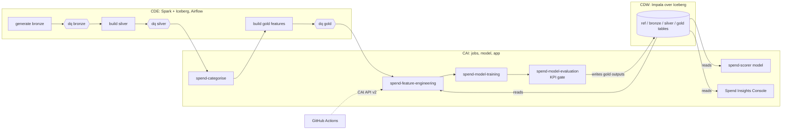

# How it works

Nine questions about the design, answered from the code. File paths point to where
each piece lives. Numbers are from the run published on the federal cluster for
2026-09-28 (run `20260928-d0b1059b`), unless another run is named.



## 1. Master data management

There is no separate MDM product. The pipeline builds one governed master per
entity, in the `ref` and `silver` layers, with keys, lineage and data-quality
checks. There are four kinds of master data.

**Customer master (the golden record, keyed by CIF).**
- The CRM / KYC extract `bronze.crm_customer` is the system of record for the
  customer: home pincode, age band, income band, segment and onboarding date.
- `cde/jobs/build_silver.py` conforms it into `silver.customer`:
  - Duplicates re-sent by the source (0.2% of records, planted) are removed. The
    latest `ingested_at` wins, via `row_number()` over the business key.
  - The home pincode is resolved through `ref.pincode_geo` to home city, state
    and city tier.
- Every downstream table is keyed by CIF.

**Identity resolution (crosswalks from source keys to CIF).**

The card, UPI and ATM switches don't carry the CIF, so silver resolves them through
the account and registry masters:

| Source | Resolution |
|---|---|
| `crm_customer`, `nb_txn` | carry the CIF |
| `card_txn`, `atm_txn` | `card_hash` -> `card_master.account_id` -> `cbs_accounts.cif` |
| `upi_txn` | `payer_vpa` -> `vpa_registry.account_id` -> `cbs_accounts.cif` |

- An event that doesn't resolve keeps a NULL CIF. `dq_silver` gates the unresolved
  share as a critical check.
- The raw card number is never landed; only `card_hash` is.

**Merchant master (`ref.merchant_category_map`).**
- Every payee, merchant and biller name is normalised into one `merchant_key`:
  lower case, separators to spaces, reference numbers and company suffixes
  removed.
- Spark computes it in `build_silver.py` and Python in
  `spend.categorise.normalise()`. `tests/test_cde_jobs.py` checks the two agree,
  so silver, the categoriser and gold all use the same key.
- The CAI job `spend-categorise` adds new keys to the map with a category and
  the method that decided it:
  - MCC: the card MCC is known.
  - SEED: an exact match with a curated seed name.
  - EMBEDDING: MiniLM nearest neighbours.
  - FALLBACK: the nearest category description.
- The map is **append-only**. A key keeps the category of the run that first saw
  it (`first_run_date`, `run_id`, `model_id`), so history is never re-categorised.
- On the federal cluster: 21,551 keys, every merchant event mapped
  (`uncategorised_share` 0.0%).

**Reference data (the `ref` database).**
- Tables: `pincode_geo`, `mcc_category`, `category_taxonomy` (14 categories and
  their descriptions), `atm_location`, `merchant_seed` and `calendar_weekly`
  (festival, salary and school-fee weeks).
- In this demo `generate_spend_bronze.py` lands them. In production they would
  come from the bank's reference-data owners.
- `ref.archetype_truth` is synthetic ground truth. It is used only to score
  persona recovery, never as a feature.

**Quality and lineage.**
- Every layer has a Great Expectations gate (`cde/jobs/dq_check.py`) with
  critical and warning checks. Examples: null keys, orphans, unresolved events,
  duplicates, shares that don't add up, raw card numbers.
- Every result is appended to `ref.dq_results` with the Iceberg snapshot ID of
  the table checked.
- For 2026-09-28: 68 bronze, 23 silver and 27 gold checks, 0 failed.

**What it does not do.**
- There is no stewardship workflow or match/merge UI.
- The only survivorship rule is "latest ingested wins" within one source.
- A customer who moves while the CRM keeps the old pincode is detected (the
  `RELOCATION` signal, "Offer home-branch change") but not written back to the
  CRM.

## 2. CI/CD

`.github/workflows/ci.yml` runs on every push to `main`, every pull request and
on demand. It has three jobs, each needing the one before.

| Job | What it proves |
|---|---|
| `test` | Unit tests, the four Spark jobs and the GX gates on local Spark + Iceberg at small scale, the three CAI stages with the no-torch stubs, and the DQ gate failing on cue. |
| `train-validate` | The real MiniLM categoriser and Chronos-2 forecaster on the runner's CPU, KPI gate enforced: a regression turns the build red. |
| `cai-pipeline` | Pushes to `main` only. The same three stages on Cloudera AI, through the CAI API v2 (`ci/trigger_cai_pipeline.py`). |

**The `cai-pipeline` chain, "GitHub -> Train & Validate -> KPI Gate":**
1. `spend-sync-code`, with `EXPECTED_GIT_SHA`, resets the CAI project to the pushed
   commit and pip-installs `requirements.txt` when its hash has changed
   (`cai/jobs/sync_code.py`). If the branch has already moved on, the chain stops
   and the newer push runs its own.
2. `spend-feature-engineering` and `spend-model-training` write into
   `artifacts/github/`, apart from the nightly run's folders.
3. `spend-model-evaluation` runs with `SPEND_DRY_RUN=1`. The KPI gate decides and
   nothing is written. A rejection fails the check with
   `KPI GATE REJECTED the candidate`, and the published run stays live.
- The job needs the secrets `CAI_URL`, `CAI_API_KEY` and `CAI_PROJECT_ID`. Without
  `CAI_URL` it prints a notice and passes.
- On the federal cluster, GitHub's hosted runners reach the workbench. The
  chain for commit `57396ee` passed the gate.

**What counts as "the model" for CI:**
- The feature hash (`spend.features.feature_hash()`) fingerprints the feature
  definition. It is written to the manifest, to `spend_model_run.feature_hash` and
  to MLflow, and checked by the gate and the endpoint (section 6).
- The gate also checks non-regression against the published champion
  (section 6).

**Deployment (CD):**
- `cde/scripts/deploy_jobs.sh` creates the CDE repository from GitHub, the
  Python environment and the Spark jobs. Jobs read their code from the synced
  repository.
- `cde/scripts/deploy_dag.sh` registers the DAG, paused.
- `ci/setup_cai.py` creates the CAI project from Git, its environment
  variables, the five jobs (resized if they already exist), the model (built and
  deployed) and the application. It is idempotent.
- `cde/scripts/set_airflow_variables.py` sets the seven `SPEND_CAI_*` Airflow
  Variables, and only those.
- After a code change: push, then `cde repository sync` for CDE. The CAI side
  syncs itself through `spend-sync-code`, and a push that changes the model
  code rebuilds and redeploys `spend-scorer` after its gate passes (section 9).

## 3. Orchestration across CDE, CAI and CDW

One Airflow DAG on CDE, `spend_analytics_pipeline` (`cde/dags/spend_dag.py`),
runs the whole day. It is registered as the CDE job
`rsingh-spend-anl-orchestration`.

```text
generate_spend_bronze -> dq_bronze -> build_silver -> dq_silver -> cai_categorise
  -> build_gold_features -> dq_gold -> cai_feature_engineering -> cai_model_training
  -> cai_model_evaluation -> refresh_endpoint
```

- **`refresh_endpoint`** restarts `spend-scorer` over the CAI API v2 and checks
  that it serves the run just registered (section 9).

- **CDE tasks** use `CDEJobRunOperator` on the four Spark jobs, with run-time
  arguments `--db-prefix`, `--as-of` and, for data quality, `--layer` and
  `--pipeline-run` (the DAG run ID).
- **CAI tasks** use a `PythonOperator` that calls the CAI API v2:
  - It starts the job run with an environment map (`SPEND_RUN_DATE`,
    `SPEND_TRIGGERED_BY=airflow`), because a job run ignores arguments.
  - It polls every 30 s and fails the task if the run fails or takes longer than
    90 minutes.
  - Host, project, key and job IDs come from the seven Airflow Variables.
  - `retries=0`: a gate failure is not transient.
- **CDW has no tasks of its own.**
  - Spark writes Iceberg tables through the shared Hive metastore. CAI reads and
    writes the same tables through Impala (impyla, HTTP, LDAP).
  - CAI runs `REFRESH` before reading, so Impala sees the snapshots CDE has just
    committed.
  - Reports (`sql/reports.sql`), the app and the model read CDW directly.
- **Schedule:** daily at 21:00 UTC, `catchup=False` and `max_active_runs=1`. Each
  run regenerates bronze and replaces its date's outputs, so two runs must not
  overlap.
  - The DAG is registered paused (`is_paused_upon_creation=True`): with
    `catchup=False`, unpausing starts the latest closed interval at once.
  - A scheduled run's as_of is the day before its interval ends. A manual
    trigger takes `{"as_of": "YYYY-MM-DD"}`.
- **Failure behaviour:** a critical data-quality failure or a KPI gate failure
  stops the DAG (red), and yesterday's personas, forecast and signals stay
  live.
- **Sizing on the federal cluster:**
  - Spark executors are 4 cores / 8 GB, 1 minimum / 2 initial / 16 maximum.
    The larger go01 sizing was rejected by the vcluster's queue.
  - CAI training runs at 4 vCPU / 16 GB (8 / 32 waited 20 min for a node).
  - Chain times for 2026-09-28:

    | Step | Time |
    |---|---|
    | bronze | about 21 min |
    | dq bronze | 182 s |
    | silver | 153 s |
    | dq silver | 214 s |
    | categorise | 165 s |
    | gold | 395 s |
    | dq gold | 152 s |
    | feature engineering | 63 s |
    | training | 184 s |
    | evaluation | 205 s |

## 4. How the gold layer feeds the AI layer

`cde/jobs/build_gold_features.py` produces three Iceberg tables. Each is rebuilt
in full and written with `MERGE INTO`, so a load is one snapshot per table and an
unchanged week isn't rewritten.

| Gold table | Grain | Feeds |
|---|---|---|
| `gold.spend_features` | one row per CIF per snapshot (every Friday, plus the as-of date) | personas, signals, the endpoint's customer profile |
| `gold.spend_cohort_weekly` | cohort (segment x home city tier, 16) x category (14) x week, dense, with calendar covariates | Chronos-2 forecast (224 series) |
| `gold.spend_mix_weekly` | week x dimension x value x channel | the app's charts |

**The contract:**
- `spend/features.py` names the columns. The gold job keeps its own copy of the
  lists, and `tests/test_cde_jobs.py` checks the two agree.
- `feature_hash()` fingerprints the lists and `FEATURE_LOGIC_VERSION` ("1.0.0"),
  giving `aa21012976534ed4`.
- **Categories come from the merchant master.** Gold joins
  `silver.spend_event.merchant_key` to `ref.merchant_category_map`. That is why
  `cai_categorise` runs between silver and gold. `dq_gold` fails if more than 5%
  of merchant spend is uncategorised.
- **Consistent reads.** The first CAI stage pins the Iceberg snapshot IDs of
  `spend_features`, `spend_cohort_weekly` and `merchant_category_map`. Every read
  of the run then uses `FOR SYSTEM_VERSION AS OF <id>` (`spend/storage.py`), so a
  gold load committed mid-run can't mix versions. The IDs are recorded in the
  manifest and in `spend_model_run`.
- **No look-ahead.** A run for date D reads only the D snapshot, cohort weeks
  ending on or before D, and runs before D. A backfill therefore reproduces what
  the daily run would have said on those days.
- **Back to gold.** The AI layer writes its outputs back to CDW, keyed by
  `run_date` (DELETE + INSERT for that date only): `customer_persona`,
  `persona_profile`, `persona_flow`, `spend_forecast`, `spend_backtest`,
  `spend_signals` and `spend_model_run`. The model and app read these through
  Impala.

## 5. Feature engineering in CAI

There are two parts. Spark computes the features themselves at scale in gold;
the CAI job `spend-feature-engineering` (`cai/jobs/feature_engineering.py`,
`spend.pipeline.feature_engineering`) assembles the model inputs for one run date.

**In gold (Spark), per CIF over the 13 weeks to the snapshot:**
- `cat_<c>_share`: 14 category shares of categorised merchant spend, summing to 1.
- `ch_<c>_share`: 6 channel shares.
- `tier<n>_share`: 4 city-tier shares.
- `home_share` and `digital_share`.
- `salary_week_share`.
- `away_share_4w`: located spend outside the home city in the last 4 weeks. Home
  fallbacks are left out, so an event with no location doesn't dilute a move.
- `away_weeks_4w`: weeks where at least half the located spend was away. A move
  persists; a trip doesn't.
- Totals and trend: `spend_13w`, `txn_13w`, `avg_ticket`, `merchant_spend_13w`,
  `spend_4w`, `txn_4w` and `spend_trend_4v13`.
- `cat_<c>_4w`: INR per category in the last 4 weeks, used by the signals.
- `uncategorised_share`.
- Descriptive columns: segment, age band, income band, home city, state, tier
  and cohort.

**In the CAI job, for run date D:**
1. `REFRESH` gold and the `ref` inputs, then pin the three snapshots.
2. Read the D snapshot of `gold.spend_features` and the one 4 weeks earlier
   (`RELOCATION` compares the two).
3. Read the 224 cohort x category series up to D, with the calendar covariates.
4. Read the categoriser holdout inputs (seed variants, MCC-mapped keys).
5. Read the previous published run's personas (for stable IDs).
6. Write it all to `artifacts/<D>/` on the project filesystem, with
   `manifest.json`: run ID, snapshot IDs, feature hash, champion run and its
   KPIs.

**The model's feature set:**
- Personas use `PERSONA_FEATURES`: the 24 share columns + `log1p(spend_13w)` +
  `digital_share` + `home_share`.
- Only customers with at least 5 transactions in 13 weeks are profiled: 193,456
  on 2026-09-28.
- The scaler is fitted at training time. It is stored with the centroids in
  `persona_profile` and re-applied by the endpoint. The feature hash makes sure
  both sides use the same definition.

## 6. Model training and evaluation

**Training:** CAI job `spend-model-training` (`cai/jobs/train_models.py`). It reads
`artifacts/<D>/` and writes outputs and `metrics.json` back there; nothing goes to
CDW.
- **Personas** (`spend/personas.py`):
  - KMeans on the standardised persona features, clipped at +-3 sd.
  - k is chosen from 5 to 9 by silhouette on a 20,000-row sample. The previous
    k is kept unless another beats it by more than 0.01.
  - IDs are matched to the previous run's centroids (Hungarian algorithm), so
    persona 3 stays persona 3.
  - Names are rules on the centroid, e.g. "Tier-1 digital foodie".
- **Categoriser holdouts** (`spend/categorise.py`): MiniLM + character n-grams,
  scored on two holdouts:
  - 20% of the seed variants, left out of the index.
  - Card merchants with the MCC hidden.
- **Forecast** (`spend/forecast.py`):
  - Chronos-2, zero-shot, on each series with the calendar as known future
    covariates, producing P10 / P50 / P90 and the mean.
  - A 4-cut-off rolling backtest (12 weeks hidden each time) against seasonal
    naive (same week last year x recent trend).
  - Then the 12-week forecast.
- **Signals** (`spend/signals.py`): the rules in `config/policy.yaml`
  (`TRAVEL_SURGE`, `FESTIVE_ELECTRONICS`, `RELOCATION`), applied to D's
  features. Changing a rule re-lists customers without touching a model.

**Evaluation:** CAI job `spend-model-evaluation` (`cai/jobs/evaluate_models.py`).
1. **KPI gate** (`spend/gate.py`, thresholds in `config/policy.yaml`):

   | Check | Rule | 2026-09-28 |
   |---|---|---|
   | categoriser, seed holdout | accuracy >= 0.85 | 0.926 |
   | categoriser, hidden MCC | accuracy >= 0.85 | 0.934 (n=2,937) |
   | forecast | WAPE <= 0.90 x seasonal naive | 0.0998 vs 0.1144 (ratio 0.872) |
   | forecast | P10-P90 coverage in [0.60, 0.95] | 0.779 |
   | personas | silhouette >= 0.15 | 0.163 (k=8) |
   | personas | stability >= 0.80 vs the previous run | skipped on a first run |
   | non-regression | each accuracy >= champion - 0.01; WAPE ratio <= champion + 0.03 | skipped: nothing published before |
   | consistency | feature hash equals the code's | `aa21012976534ed4` |

   - The champion is the published run the candidate would replace: the same
     run date's, else the last one before.
   - A KPI that can't be measured fails its check, so a broken stage can't pass
     by producing nothing.
2. **MLflow** (CAI Experiments, experiment `spend-analytics`): parameters, KPIs
   and gate detail are logged before the tables are written, so
   `spend_model_run.mlflow_run_id` links the two (`9jep-ssq2-t3wf-w8ql` for
   2026-09-28).
3. **Publish:**
   - If the gate passed, it writes `customer_persona`, `persona_profile`,
     `persona_flow`, `spend_forecast`, `spend_backtest`, `spend_signals`, then
     `spend_model_run`. 2026-09-28: 193,456 personas, 2,688 forecast rows,
     12,518 signals.
   - If it failed, only `spend_backtest` and `spend_model_run`
     (`gate_passed = false`) are written as evidence. The job exits 1, and
     yesterday's outputs stay live.
4. **Serving:**
   - The `spend-scorer` model (`cai/model/predict.py`) loads the latest published
     run from CDW and refuses a run whose feature hash differs from its code's.
   - It answers four actions: profile, 12-week forecast, what-if and live
     categorise.
   - The app and the Customer 360 tab call it.
   - The DAG's `refresh_endpoint` task restarts it after each published run
     and checks that it serves that run.

In one process: `cai/jobs/daily_run.py` runs the three stages together (sessions,
CI). `cai/jobs/backfill_history.py` replays past Fridays in order, each
chained to the previous run.

## 7. The banking data model and the semantic layer

MDM is done by the pipeline (section 1), so the data model is the table layout
itself. It is a small party-account-transaction model, not an industry model
such as BIAN or Teradata FSLDM. There is no separate semantic-layer product:
definitions live in shared code, and gold is built to be read as it is.

**The model by layer.**

| Layer | Entity | Tables | Key |
|---|---|---|---|
| bronze | one extract per source system | `crm_customer` (CRM / KYC), `cbs_accounts` (core banking), `card_master` + `card_txn` (card switch), `vpa_registry` + `upi_txn` (UPI switch), `nb_txn` (net banking), `atm_txn` (ATM switch) | the source's own key |
| ref | reference data and dimensions | `pincode_geo`, `mcc_category`, `category_taxonomy`, `atm_location`, `merchant_seed`, `calendar_weekly`, `merchant_category_map` | pincode, MCC, category, merchant key, week |
| silver | party | `customer` | `cif` |
| silver | arrangement | `account` (product, branch, opened on, status) | `account_id` -> `cif` |
| silver | transaction (one fact for all channels) | `spend_event` | `event_id`, with `cif`, `account_id`, `channel`, `merchant_key`, `week_end`, event location, `is_home` |
| gold | marts | `spend_features` (customer x week), `spend_cohort_weekly` (cohort x category x week), `spend_mix_weekly` (week x dimension x channel) | as named |
| gold | model outputs | `customer_persona`, `persona_profile`, `persona_flow`, `spend_forecast`, `spend_backtest`, `spend_signals`, `spend_model_run` | `run_date` plus the grain |

- Card and UPI instruments are linked to the account, not to the customer
  (`card_hash` and `vpa` -> `account_id` -> `cif`), as in a core banking model.
  That is how silver resolves six sources to one CIF.
- `spend_event` is one conformed transaction fact. The four transaction feeds
  are mapped onto one column list (`EVENT_COLUMNS` in `build_silver.py`) with a
  common channel set: CARD_POS, CARD_ECOM, UPI_P2M, UPI_P2P, NETBANKING and
  ATM_CASH.
- Gold is modelled for its readers. The app's book-wide charts read only
  `spend_mix_weekly` and never scan silver. The models read `spend_features` and
  `spend_cohort_weekly`.

**Where the semantic definitions live.**

Each business term is defined once, in code, and every engine uses that
definition:

| Term | Defined in | Kept in step by |
|---|---|---|
| Feature columns, the 14 categories, 6 channels, 4 tiers, cohorts (`segment\|T<tier>`) | `spend/features.py` | `tests/test_cde_jobs.py` checks the Spark gold job's column lists against it |
| `merchant_key` | `build_silver.merchant_key()` (Spark) and `spend.categorise.normalise()` (Python) | the same test checks the two give the same key |
| Week (Saturday to Friday, `week_end` = the Friday) | `build_silver.week_end()` and `spend.features` | tests |
| Category descriptions, MCC to category | `ref.category_taxonomy`, `ref.mcc_category` | data-quality checks |
| Shares, trend and away weeks | `build_gold_features.py` docstring and code, PLAN.md decision 3 | `dq_gold` (shares must sum to 1) |
| Signal rules, thresholds and actions | `config/policy.yaml` | the gate and tests |
| The feature definition as a whole | `feature_hash()` = `aa21012976534ed4` | the gate and the serving model refuse a mismatch (section 2) |

- CDW Impala reads the same Iceberg tables through the shared metastore. Anyone
  querying in Hue or CDW sees the same column names and grains as the app and
  the models.
- The app's Lineage tab shows the SQL to reproduce a run:
  `SELECT ... FROM gold.spend_features FOR SYSTEM_VERSION AS OF <snapshot_id>`.

**What is not there.**
- No metrics layer (for example a dbt semantic model) and no business glossary
  in a catalog. The pipeline's definitions are in code and docs.
- The reporting views in `rsingh_spend_anl_report` (`sql/dataviz_views.sql`)
  give gold business columns (crore, Digital/Physical, Tier N, persona change,
  gate PASS/FAIL, latest-run flags). They feed the Data Visualization dashboard
  "Spend Analytics - Insights" (7 datasets, 40 visuals, 6 sheets), built as
  code by `dataviz/build_dashboard.py` into the shared workspace
  `rsingh-spend-anl` (`docs/CDV_DASHBOARD.md`). Nothing in the pipeline reads
  the views.

## 8. SCD2 and history in Iceberg

**No table here is SCD2.** No table has `valid_from` / `valid_to` /
`is_current` rows. History is kept in two other ways: Iceberg snapshots
(time travel) and tables whose key includes a date.

**How each layer writes.**

| Layer | Write | What happens to history |
|---|---|---|
| bronze, ref (generated), silver | `createOrReplace()` every run (`_write` in `generate_spend_bronze.py` and `build_silver.py`) | The table holds only the current state, SCD type 1. Each replace is a new Iceberg snapshot, and earlier snapshots are still readable. |
| `silver.customer` | deduplicated by CIF, latest `ingested_at` wins, then replaced | One row per customer with today's attributes. A change of segment or home pincode overwrites the old value. |
| gold marts | `MERGE INTO` (`bootstrap_or_merge` in `build_gold_features.py`): update changed rows, insert new ones, delete rows the rebuild no longer produces | One Iceberg snapshot per load. An unchanged week is not rewritten. |
| `ref.merchant_category_map` | append-only | A merchant key keeps the category it was first given, with `first_run_date`, `run_id` and `model_id`. The category is never changed later. |
| `ref.dq_results` | append-only | One row per check per run, with the checked table's snapshot ID. |
| CAI outputs (`customer_persona` ... `spend_model_run`) | DELETE + INSERT for the run date (`spend/storage.py`) | Keyed by `run_date`, so every published day stays queryable. A rerun of a date replaces only that date. |

**Time travel instead of SCD2.**
- Each CAI run records the snapshot IDs it read (`features_snapshot_id`,
  `cohort_snapshot_id`, `map_snapshot_id` in `spend_model_run`). It reads gold
  with `FOR SYSTEM_VERSION AS OF`, so a past run can be reproduced exactly even
  after gold has moved on.
- `ref.dq_results` ties each quality result to the snapshot it checked.
- The repo never runs `expire_snapshots`. How long snapshots survive depends on
  the cluster's table maintenance, so time travel is not a long-term archive.

**Where this matters.**
- Gold's customer attributes (segment, age band, income band, home city, tier,
  cohort) come from today's `silver.customer` and are joined onto every weekly
  snapshot. `spend_event.is_home` uses today's home city too. If the CRM changes
  a customer's segment or home pincode, the next gold MERGE restates that
  customer's past weeks with the new values. The spend amounts don't change;
  the attributes and home/away labels do.
- The synthetic CRM has no attribute changes (one record per CIF plus re-sent
  duplicates), so this hasn't happened in any run so far.

**Adding SCD2 to the customer master (not built).**
1. Add a `silver.customer_history` table with `valid_from`, `valid_to` and
   `is_current`, keyed by CIF and `valid_from`.
2. Load it each run with an Iceberg `MERGE INTO`: close the current row when a
   tracked attribute changes, and insert the new version.
3. In `build_gold_features.py`, join on
   `snapshot_date BETWEEN valid_from AND valid_to` instead of the current row,
   so each weekly snapshot carries the attributes in force that week.
4. `silver.customer` becomes the `is_current` view of the history table, so
   nothing else changes.

## 9. Model management

There are four models. Two are pretrained and used as they are, one is
retrained daily, and one is a rule set:

| Model | Kind | Trained | Stored as |
|---|---|---|---|
| Categoriser | MiniLM (`sentence-transformers/all-MiniLM-L6-v2`) blended with character n-grams, 5-NN | Never fine-tuned; new keys only | `ref.merchant_category_map` (append-only, `model_id` per key) |
| Forecaster | Chronos-2 (`amazon/chronos-2`), zero-shot with calendar covariates | Never fine-tuned | Forecasts in `spend_forecast`, accuracy in `spend_backtest` |
| Personas | KMeans, k from 5 to 9 by silhouette, IDs matched to the previous run | Retrained every run | Scaler in `spend_model_run.scaler_json`, centroids in `persona_profile.centroid_json` |
| Signals | Rules and thresholds | Not trained | `config/policy.yaml`, versioned in git |

**Versioning.** Each run writes one `spend_model_run` row. It records:
- `run_id` and `run_date`, and what triggered it (`airflow`, `github`, or `cai-job` for a direct run).
- `embedder_id`, `forecaster_id` and `model_versions`: the installed versions of
  sentence-transformers, chronos-forecasting, torch and scikit-learn.
- `feature_hash`, and the snapshot IDs of the data it read.
- Every KPI, the gate verdict and detail, `outputs_published`, the stage
  durations and the `mlflow_run_id`.

`spend_model_run` is the record of every run. The Cloudera AI Registry holds
the approved persona models (below).

**Experiment tracking.**
- `spend/tracking.py` logs every run to the CAI Experiments (MLflow) experiment
  `spend-analytics`: the same parameters, KPIs as metrics, gate tags, and the
  gate detail and per-k silhouettes as artefacts.
- It also logs the persona model itself under `model`: a plain scikit-learn
  pipeline (standardise, clip at ±3, nearest centroid; `spend/registry.py`)
  with a tensor signature of the 27 persona features and an input example.
  It assigns exactly what the daily job assigns (`tests/test_registry.py`).
- A tracking error never fails the run.

**Registry (Cloudera AI Registry, `spend-persona`).**
- After a published run's tables are written, the evaluation job registers
  that MLflow run's model as a new version of `spend-persona`
  (`spend.registry.registrar`, through `cmlapi` with the job's own
  credentials).
- A failed gate registers nothing, and neither does a backfilled date older
  than the latest published one. So the highest version is always the
  champion: the run the endpoint serves.
- Each version carries its MLflow run's parameters and metrics: run ID,
  snapshot IDs, feature hash, package versions, git commit and every KPI.
  That is the lineage from a registered model back to the data it was
  trained on.
- The registry (`model-registry-ml-83cd393d-eba`) has public internet access.
  The first one was private, and calls to models deployed from it timed out.
- Version 1 is run `20260928-9b0c34ed` (an evaluation rerun on 2026-10-01).
  Version 2 is run `20260929-d12f93a1`, registered by the nightly DAG run.
- Updating a version's tags through the API v2 never returned on this
  workbench (18 minutes), so nothing depends on tags.

**Promotion and rollback (champion and challenger).**
- Each run is a challenger. Its champion is the published run it would replace.
- The KPI gate (`spend/gate.py`, `config/policy.yaml`) checks absolute floors and
  non-regression against the champion: each accuracy may drop by at most 0.01,
  and `wape_ratio` may rise by at most 0.03.
- Pass: the outputs are published, the model is registered, and the run becomes
  the champion.
- Fail: only the evidence is written. The champion stays live, so rollback is
  automatic and nobody has to act.
- CI enforces the same gate: `train-validate` on every push, and the GitHub to
  CAI chain on the cluster (section 2).

**Deployment: a new model and new code reach the endpoint by themselves.**

| What changed | What redeploys it | Measured on 2026-09-30 |
|---|---|---|
| A new daily run (retrained personas) | DAG task `refresh_endpoint`, after `cai_model_evaluation`: restarts `spend-scorer`, then calls it until it serves the champion version's run | Restart to first correct answer: 560 s by hand; 60 s in the DAG run for 2026-09-29 |
| Model code (`spend/`, `cai/model/`, `config/`, `requirements.txt`, `cdsw-build.sh`) | The GitHub to CAI chain, after its KPI gate passes: a new `spend-scorer` build of the commit, deployed when built; the previous deployment is stopped | Build 8 min, deploy 2 min 48 s (commit `68825eb`) |
| A new registry version (the same nightly run) | DAG task `deploy_registry_model`, beside `refresh_endpoint`: a build of the new version into `spend-persona-registry`, deployed when built, then one call | Version 2 build to deployed: 185 s (by hand, same API calls) |
| Anything else (docs, tests) | Nothing | |

- `spend-scorer` loads the latest published run's scaler, centroids and
  snapshot IDs at start-up. It refuses to start if that run's feature hash
  differs from its own code, and every response names the run it serves.
- `refresh_endpoint` fails the DAG run if the endpoint doesn't serve the
  expected run within 30 minutes.
- The endpoint is down for the restart, about 9 minutes after each nightly
  run (around 03:20 IST).

**Deploying straight from the registry (`ci/deploy_registered_model.py`).**
- Creates the workbench model `spend-persona-registry` from the registered
  model and builds it from the champion version, with no code file
  (1 vCPU / 2 GB). Run again, it adds a build only when a newer version exists.
- Moving it from version 1 to version 2 took 185 s, build to deployed.
- It answers one call: rows of the 27 persona features, in order, to
  `persona_id`. The `inputs`, `instances` and `dataframe_split` request formats
  all work. The 8 centroids of the 2026-09-29 run come back as personas 0 to 7
  (the traveller is 4): 3 to 4 s for the first call, 0.3 s after that.
- The signature is float64: MLflow won't narrow JSON numbers to a float32
  tensor (HTTP 400 on every call, reproduced locally).
- A registry build can still report "pushing" after its deployment is up, so
  the script and the DAG task wait on the deployment.
- A request made only of whole numbers (`0.0`, `1.0`) reaches MLflow as
  integers and gets HTTP 400. One fractional value anywhere in the request is
  enough, so real feature rows are fine; the DAG's check call uses 0.5s.
- After that, the DAG task `deploy_registry_model` moves it to each night's new
  version. It skips (no failure) if the registry lists no version for the
  night's date within 5 minutes.

**Gaps.**
- In the 2026-09-29 DAG run, `refresh_endpoint` found no registry version
  40 s after version 2 was created and fell back to the run-date check (it
  passed). Both registry tasks now wait up to 5 minutes for the night's
  version and log why they fall back.
- The Hugging Face weights are not pinned to a revision, and `requirements.txt`
  uses `>=`. `model_versions` records what ran, but a rebuild could pull newer
  weights. For air-gapped or strict use, set `model.local_dir`
  (`SPEND_MODEL_LOCAL_DIR`) to a vetted copy of the weights and pin the
  packages.
- Only the persona model is versioned in the registry. MiniLM and Chronos-2 are
  recorded by name and package version in each run, not as registered models.
